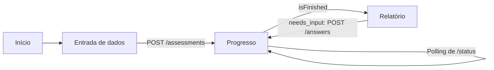

# Vencar App

Frontend da Vencar, criado para o AKCIT CAMP. A pessoa informa os dados do carro e envia fotos, acompanha a análise do agente de IA e recebe um relatório técnico com o Score Vencar.

> **Estado atual:** protótipo. O app usa um token de teste, sem login real, e depende da [API da Vencar](https://github.com/vencar-hackathon-akcit/vencar) em execução.

## Como rodar

**Pré-requisitos:** Node.js e o backend em execução em `http://localhost:8000`.

```bash
npm install
```

```bash
cp .env.example .env.local
```

```bash
npm run dev
```

O app abre em `http://localhost:3000`, a origem liberada por padrão no CORS do backend. Se mudar a porta, ajuste também `VENCAR_CORS_ORIGINS` no backend.

## Configuração

| Variável | Padrão | Descrição |
|---|---|---|
| `VITE_API_URL` | `http://localhost:8000` | Endereço da API |
| `VITE_API_TOKEN` | `teste-usuario-a` | Token enviado em todas as chamadas |

Variáveis `VITE_` ficam visíveis no navegador. Não coloque segredos reais nelas.

## Páginas

| Rota | Página | O que faz |
|---|---|---|
| `/` | Início | Apresenta o produto e leva à avaliação |
| `/avaliacoes/nova` | Entrada de dados | Recebe veículo, relato e até 10 fotos, com validação e pré-visualização |
| `/avaliacoes/{id}/progresso` | Progresso | Consulta o status e mostra a etapa atual do agente |
| `/avaliacoes/{id}/relatorio` | Relatório | Mostra o resultado e permite responder às perguntas do agente |



### Relatório

O relatório separa o que foi observado nas fotos do que é hipótese da IA, e mostra:

- Dados do veículo e fotos enviadas
- Score, cobertura e categorias não avaliadas
- Avarias observadas e hipóteses
- Conflitos, perguntas, informações pendentes, limitações e alertas
- Resumo, recomendação e aviso de validação humana
- Histórico das decisões e ferramentas do agente, com a verificação de integridade

O score sempre deve aparecer como provisório e, quando aplicável, parcial. Hipóteses não são diagnóstico.

## API

As chamadas ficam em `src/lib/api.ts` e enviam `Authorization: Bearer <token>`.

| Função | Rota |
|---|---|
| `createAssessment` | `POST /api/v1/assessments` |
| `getProgress` | `GET /api/v1/assessments/{id}/status` |
| `getAssessment` | `GET /api/v1/assessments/{id}` |
| `answerAssessment` | `POST /api/v1/assessments/{id}/answers` |
| `getPhotoBlob` | `GET /api/v1/assessments/{id}/photos/{photoId}` |

As fotos exigem autenticação, por isso são buscadas como blob. O contrato completo está na [documentação do backend](https://github.com/vencar-hackathon-akcit/vencar).

## Estrutura

```text
src/
├── main.tsx, App.tsx         Entrada do app e escolha da página
├── pages/                    Início, entrada de dados, progresso e relatório
├── components/
│   ├── assessment/           Fotos, score, respostas e histórico
│   └── ui/                   Estrutura da página e elementos compartilhados
├── lib/
│   ├── api.ts                Chamadas à API
│   ├── assessmentTypes.ts    Tipos da API
│   ├── assessmentDraft.ts    Dados levados da página inicial ao formulário
│   ├── config.ts             Configuração
│   ├── labels.ts             Textos em português para valores da API
│   ├── router.tsx            Navegação sem biblioteca externa
│   ├── theme.ts              Tema claro e escuro
│   └── validation.ts         Validação do formulário
└── index.css                 Tokens de design e estilos globais
public/assets/                Logo e vídeos
```

**Stack:** React 19, TypeScript, Vite, Tailwind CSS 4, Motion e Lucide.

## Desenvolvimento

| Comando | Descrição |
|---|---|
| `npm run dev` | Inicia o servidor local na porta 3000 |
| `npm run build` | Gera a versão de produção em `dist/` |
| `npm run preview` | Serve a versão gerada |
| `npm run lint` | Verifica os tipos com TypeScript |
| `npm run clean` | Remove os arquivos gerados |

Em um servidor de produção, as rotas precisam devolver `index.html`, porque a navegação acontece no navegador. Não há testes automatizados no projeto ainda.

## Limitações

- **Autenticação:** não há login, e o token de teste fica no código enviado ao navegador.
- **Dados:** use apenas dados de teste enquanto o backend estiver no plano gratuito do Gemini.
- **Stack planejada:** o app usa Vite e roteamento próprio, não Next.js. shadcn, react-icons, Recharts e Highcharts também não foram adotados.
- **Código antigo:** `src/components` ainda tem componentes do protótipo original de valuation que não são usados pelas páginas atuais. O mesmo vale para dependências como `@google/genai`, `express` e `dotenv`, que podem ser avaliadas para remoção.
